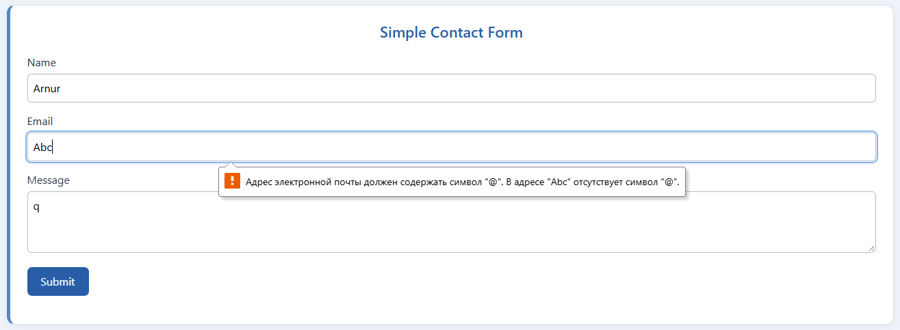
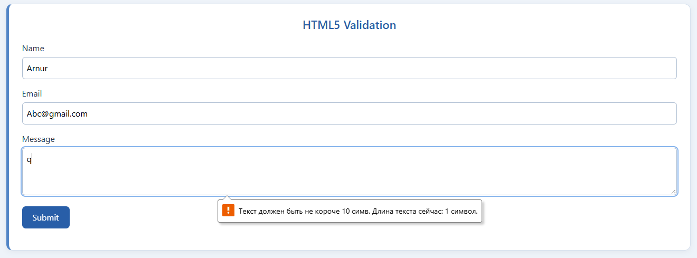
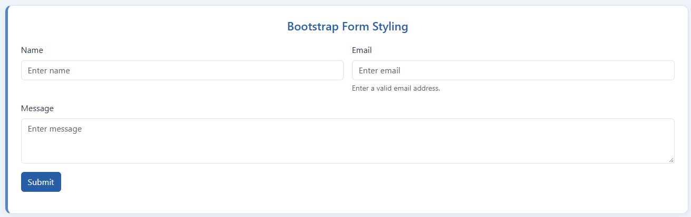
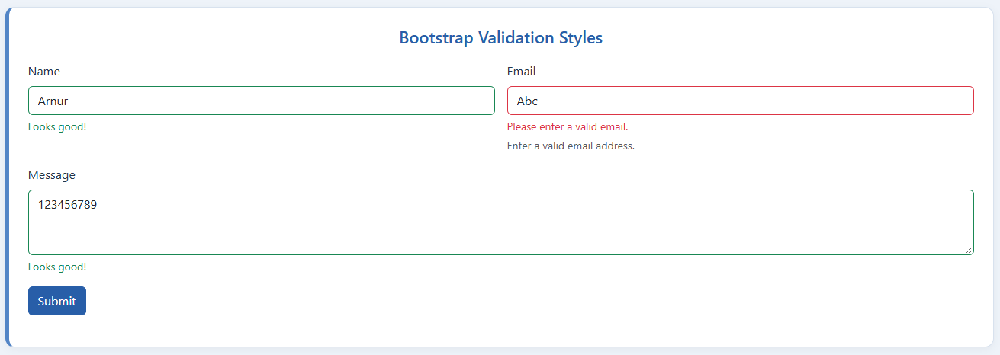
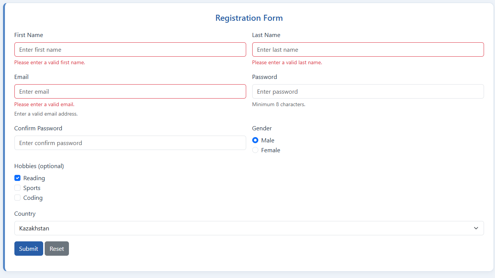

# Assignment 4 — Forms and Validation
Name: Arnur Marat  
Group: SE-2540

A simple page with five form sections

## Task 0 — Simple Contact Form
Name, email, message, submit, and associated labels. The first section contains the basic form.

## Task 1 — HTML5 Validation
Required fields, email type, minlength and maxlength. Submit an empty form or an invalid email to see native browser feedback.

## Task 2 — Bootstrap Form Styling
Bootstrap form-control, form-label, form-text, row, col-md-6 and buttons. Fields stack on small screens.

## Task 3 — Bootstrap Validation Styles
HTML5 validates the fields. CSS :user-valid and :user-invalid show Bootstrap feedback after interaction.

## Task 4 — Registration
First and last names, email, password and confirmation, gender radios, optional hobby checkboxes, country select, submit and reset. Both password fields require at least 8 characters. Reset restores the fields.

## Work summary
I created five forms, linked each label to its input, added HTML5 constraints, and used Bootstrap grid and feedback classes. No JavaScript is included. Validation uses HTML5 and CSS. There is no backend or account creation. Valid submission uses normal browser navigation; password fields have no name attributes and are excluded from submission.